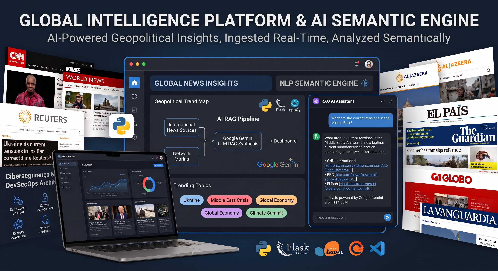

# Global Intelligence Platform & AI Semantic Engine

An enterprise-grade geopolitical news intelligence aggregator and interactive **AI-powered RAG (Retrieval-Augmented Generation)** platform driven by **Google Gemini 2.5 Flash API**, **Python**, **Flask**, **SQLAlchemy**, and **Scikit-Learn**.



Designed for high-productivity data analytics and real-time decision-making, the platform ingests live headlines from top-tier global news agencies, processes telemetry through an advanced NLP/ML pipeline, and delivers contextualized insights via LLMs and robust DevSecOps practices.

---

## 🏛️ System Architecture & RAG Pipeline


```

┌─────────────────┐      ┌────────────────────┐      ┌──────────────────┐
│  International  │ ───> │ Real-Time Scraper  │ ───> │ SQLite Database  │
│  News Sources   │      │ (Defensive TLS)    │      │ (news_intel.db)  │
└─────────────────┘      └────────────────────┘      └──────────────────┘
│
▼
┌─────────────────┐      ┌────────────────────┐      ┌──────────────────┐
│  Web Dashboard  │ <─── │  Google Gemini API │ <─── │ Vector Engine    │
│ (Tailwind CSS)  │      │ (LLM RAG Synthesis)│      │ Subword N-Grams  │
└─────────────────┘      └────────────────────┘      └──────────────────┘

```

---

## 🚀 Key Features & High-Market Value Technologies

* **Google Gemini 2.5 Flash LLM Integration:** Cutting-edge generative AI capabilities leveraging the official Google GenAI SDK (`google-genai`). The platform formats live news context into zero-shot/few-shot prompts, generating hallucination-free geopolitical summaries with direct citation groundedness.
* **Hybrid Semantic Engine (ML + LLM):** Combines character-level **$N$-Gram TF-IDF Vectorization** and **Cosine Similarity** for ultra-fast local retrieval with top-tier LLM inference for natural language understanding.
* **Automated Data Ingestion:** Multi-source web scraper harvesting real-time breaking news from leading global outlets (*CNN, BBC, Reuters, El País, G1, Al Jazeera, etc.*).
* **Dynamic NLP & Trend Extraction:** Entity recognition and trending topic frequency mapping powered by `spaCy`.
* **High-Productivity UI/UX:** Dark-mode analytical dashboard built with Tailwind CSS, featuring asynchronous chat widgets (Fetch API) and real-time category filtering.

---

## 🛡️ High-Level Cybersecurity & DevSecOps Architecture

Security is integrated natively into the software development lifecycle (AppSec):

* **Secrets Management & Zero Trust:** API Keys (`GEMINI_API_KEY`) and application secrets are strictly managed via system environment variables. Zero hardcoded credentials or unencrypted fallback values.
* **Input Sanitization & Injection Defense:** All user inputs directed to the chat API undergo rigorous multi-stage regex sanitization and unicode normalization (`unicodedata`) to mitigate **Prompt Injection**, **XSS**, and **SQL Injection** risks.
* **Network & SSRF Mitigation:** The scraping engine enforces strict URL scheme validation (`http://` / `https://`) and URL domain alignment to prevent **Server-Side Request Forgery (SSRF)** during HTTP session execution.
* **Secure Session Handling:** Flask session objects leverage HTTP-only cookie structures to maintain current-batch isolation (`ultimo_lote_ids`) without state tampering.
* **Repository Hardening:** Strict `.gitignore` rules prevent unintended exposure of SQLite databases (`*.db`), virtual environment artifacts (`.venv/`), and runtime environment files (`.env`).

---

## 🛠️ Tech Stack

* **AI & Machine Learning:** Google GenAI SDK (`gemini-2.5-flash`), Scikit-Learn (TF-IDF, Cosine Distance), spaCy, NumPy
* **Core Backend:** Python 3.12+, Flask (Application Factory & Blueprints), SQLAlchemy, Werkzeug
* **Data Mining & Networking:** Requests, BeautifulSoup4, Urllib3 (Resilient Session Management)
* **Frontend:** HTML5, Tailwind CSS, Async Fetch API (Vanilla JS)

---

## ⚙️ Quick Start & Configuration

### 1. Environment Setup
```bash
# Clone the repository
git clone <repository-url>
cd script_pagina

# Create virtual environment
python -m venv .venv

# Activate environment (Windows PowerShell)
.venv\Scripts\activate
# Activate environment (Linux/macOS)
source .venv/bin/activate

```

### 2. Install Requirements & NLP Models

```bash
pip install -r requirements.txt
python -m spacy download pt_core_news_sm

```

### 3. API Key & Launch

```bash
# Configure API Key (Optional for LLM features, local ML vector search available as baseline)
$env:GEMINI_API_KEY="YOUR_GEMINI_API_KEY_HERE" # Windows PowerShell
export GEMINI_API_KEY="YOUR_GEMINI_API_KEY_HERE" # Linux/macOS

# Set Flask Entrypoint & Run
$env:FLASK_APP="run.py"
flask run

```

Access the application at `http://127.0.0.1:5000`.

---

## 🎓 Academic & Personal Disclaimer

> **Note:** While engineered to meet production-grade performance, scalability, cybersecurity, and architectural standards, this platform is a **personal and academic project**. It was developed strictly for educational research, hands-on mastery of **Flask microservices**, **Data Mining/Scraping pipelines**, **AppSec/DevSecOps design**, and **Modern LLM RAG Implementations**.
